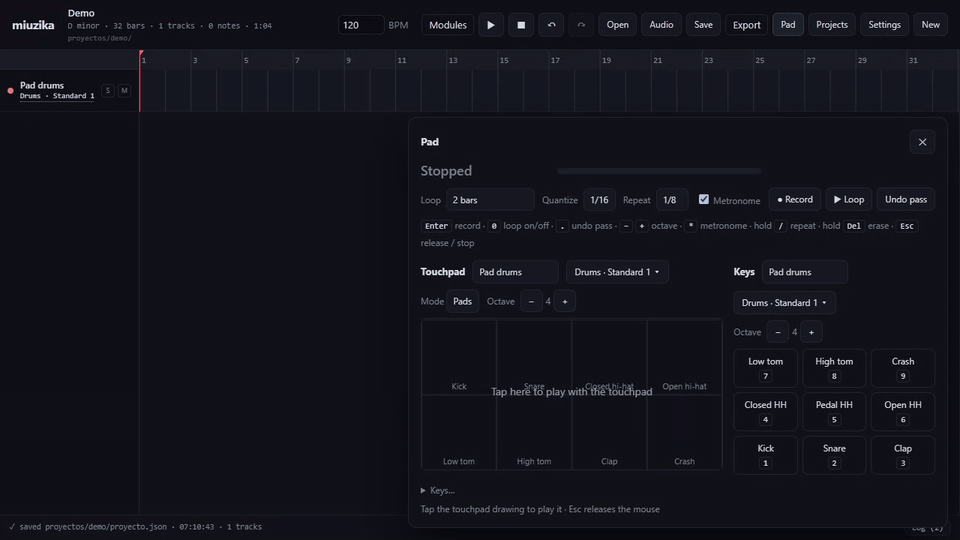

# miuzika

An experimental music workstation in the browser, built on the [openDAW](https://opendaw.org) engine. Make a song from
MIDI, audio and generated material, in a timeline you control.

There is **no language model between the interface and the music models**: a form's text goes to the model byte for byte,
and the same request does the same thing every time.



*The Pad: a drum loop built pass by pass on the numpad (kick, snare, hats with note repeat, crash), then a melody on a
synth track over it. Each track ends up with one clip.*

## What it does

**The workstation**
- A timeline of MIDI and audio tracks, with a piano roll, copy/paste/duplicate, mute and solo, undo/redo and autosave.
- Import WAV, MP3, FLAC and OGG (converted to 24-bit WAV on arrival) and `.mid` files. A new project takes its tempo from the file.
- An instrument picker for MIDI tracks: the 128 General MIDI programs, 12 drum kits (GeneralUser GS) and openDAW's synths.
- Export the mix to MP3 or WAV with the same engine as Play, and the MIDI tracks to a `.mid`.
- **To MIDI**: turns an audio track into a MIDI track with [Basic Pitch](https://github.com/spotify/basic-pitch), on this
  computer, with no GPU. It works best on a clean stem (bass, melody, chords), not on a full mix.

**Pad: play and record live**
- The laptop's touchpad and the computer keyboard are both instruments, each with its own track and instrument.
- The touchpad has three modes: keys, drum pads, or sliding pitch. It follows the project's key.
- The keyboard gives nine keys: on the numpad, or on Z X C / A S D / Q W E. On a drum track they are nine drum pieces;
  on any other track, nine notes of the project's scale.
- Loop recording, like a hardware sampler: N bars repeat, and each pass adds a layer.
  - You can undo the last pass, erase notes while the loop plays, use note repeat, a metronome and optional quantize.
  - On stop, each track gets one clip with all its layers.
- Every key can be changed. Touchpad capture needs Windows with a Precision Touchpad; the keyboard works anywhere.

**Modules: what generates material** (in the *Modules* menu)

| Module | What it does | Runs on | Licence of the model / output |
|---|---|---|---|
| ACE-Step | Song or part from text (caption, lyrics, BPM, key); cover, repaint, extract, complete | Rented GPU | MIT |
| Stable Audio | Song, single instrument or sound effect from text; transform audio, repaint bars, continue | Rented GPU | Stability AI Community License (free under US$1M yearly revenue; weights gated on Hugging Face) |
| MuLaCover | A cover of a song (from audio or melody/chord MIDI) with your lyrics and style | Rented GPU | **CC BY-NC 4.0: non-commercial only** |
| Demucs | Splits a song into stems (vocals, drums, bass, other; 6-stem model optional) | Rented GPU | MIT |
| Strudel | A Strudel pattern rendered to audio and added as a track | Your browser | AGPL-3.0 |

Before Run, each GPU module shows its licence and warns that the GPU bills its time whether the result is useful or not.
Each GPU take records its lineage: model, commit, parameters and seed. A take made from a known song keeps that song's
rights, whatever the model's licence.

**The rented GPU**: the GPU modules run on a [Lambda](https://lambda.ai) instance that the app starts, uses and stops. It
bills by the hour while it is on. The header shows its state, and **⏻ Off** shuts it down. Accounts and keys go in
*Settings*; they are stored server-side and never sent back to the browser.

## Requirements

- **Node.js 24+** and npm.
- **Python 3 with numpy**, for waveform peaks and reading MIDI.
- **ffmpeg** on the PATH, for MP3 export and for importing anything that is not a PCM WAV.
- **The General MIDI SoundFont**, which is not in the repository. Download
  [GeneralUser GS](https://github.com/mrbumpy409/GeneralUser-GS) and put the `.sf2` in `workspace/catalogo/gm/`. Its licence
  is already there. Without it, MIDI tracks only have openDAW's own synths.
- Optional:
  - a Lambda account and an SSH key, for the GPU modules;
  - a Hugging Face token that has accepted the Stable Audio terms;
  - Windows with a Precision Touchpad, for the touchpad.
- To MIDI installs Basic Pitch in its own environment (`.miuzika/basic-pitch/`, about 460 MB) the first time it is used.

## Getting started

```
npm install            # always with the lockfile: without it, duplicate @opendaw packages break the types
npm run dev            # http://localhost:5180
```

Use **New** to name and open a project. Then generate something from *Modules*, drop in a WAV or a `.mid`, or open the
**Pad** and play. Projects are saved on their own in `workspace/proyectos/<name>/`.

```
npm run typecheck      # tsc --noEmit
npm run test:unit      # node --test for src/, web/ and server/
npm test               # the same, plus the openDAW contract check
npm run build:web
```

## Where things are

| Path | What |
|---|---|
| `web/src/main.ts` | Only the wiring. Its header lists the pieces: session, transport, selection, import, projects, export, Log |
| `src/core/` | The pure domain, with tests: types, transactional operations, project, music theory, MIDI export, Pad loop |
| `src/host/opendaw/` | A miuzika project turned into an openDAW project |
| `src/modulos/`, `web/src/modulos/` | The modules. Each one reads the project and hands in audio or MIDI through `anfitrion.ts`; nothing model-specific lives outside its folder |
| `server/` | The API as a Vite plugin: projects, audio, peaks, MIDI, SoundFont, GPU, Pad. It carries requests and decides nothing |
| `workspace/gpu/` | The scripts each module runs on the GPU |
| `workspace/herramientas/` | Local tools: peaks, MIDI reading, transcription, touchpad capture |
| `workspace/proyectos/` | Your projects (outside git) |
| `tmp/api.log`, `tmp/gpu.log` | One line per API request, one per GPU step |

Code identifiers and comments are partly in Spanish; the interface is in English (Spanish with `?lang=es`).

## Status

This is an experiment and is changing quickly. `ESTADO.md` records where the project stands: what has been tried, and what
each model can and cannot do according to listening tests. `BUGS.md` lists known bugs and how each one ended.

## Licence

Copyright (C) 2026 the miuzika contributors. Developed with AI assistance (Claude, Anthropic).

miuzika is free software under the **GNU Affero General Public License v3.0 or later** (`LICENSE`). It is a combined work
with openDAW (AGPL-3.0 or commercial) and uses Strudel (AGPL-3.0). If you run it as a public service, you must publish its
source.

The third-party components and their terms are listed in `NOTICE.md`. The model licences in the table above apply to
what each module downloads and generates; they are not part of this repository.
